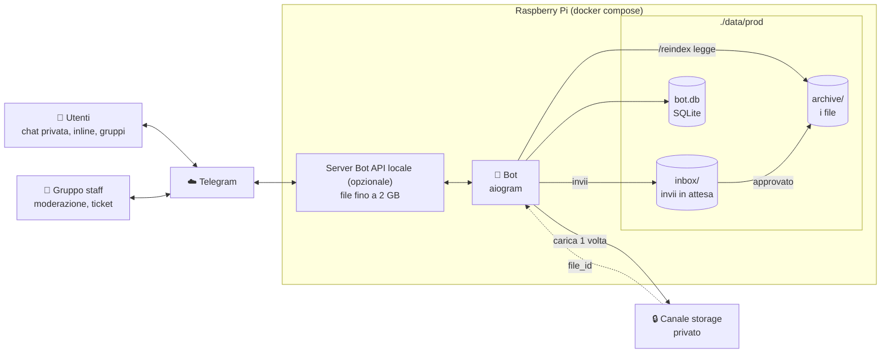
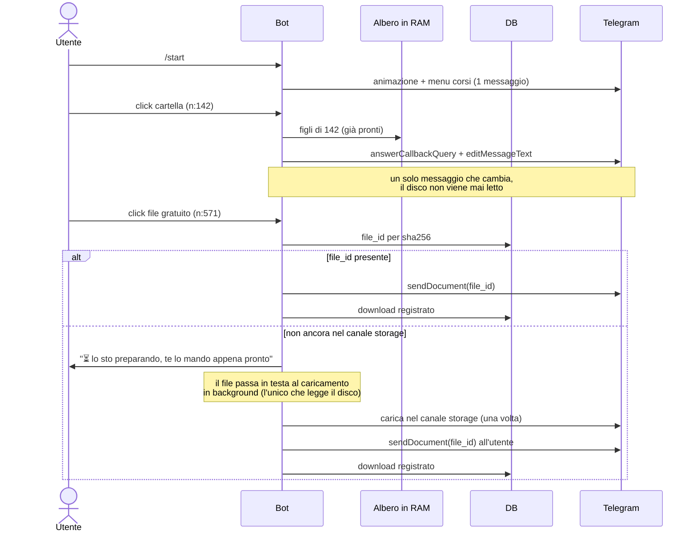
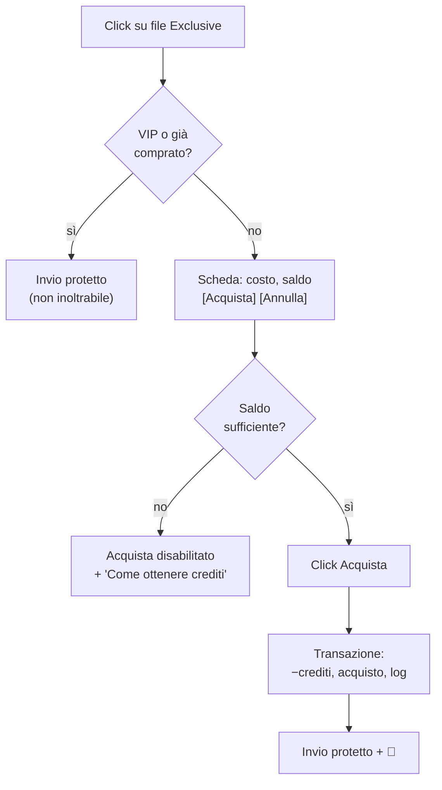
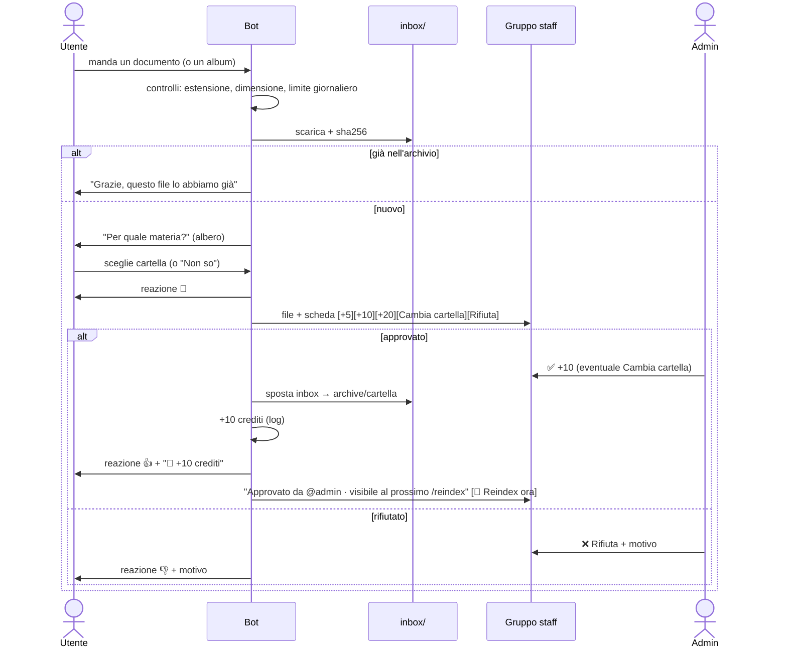
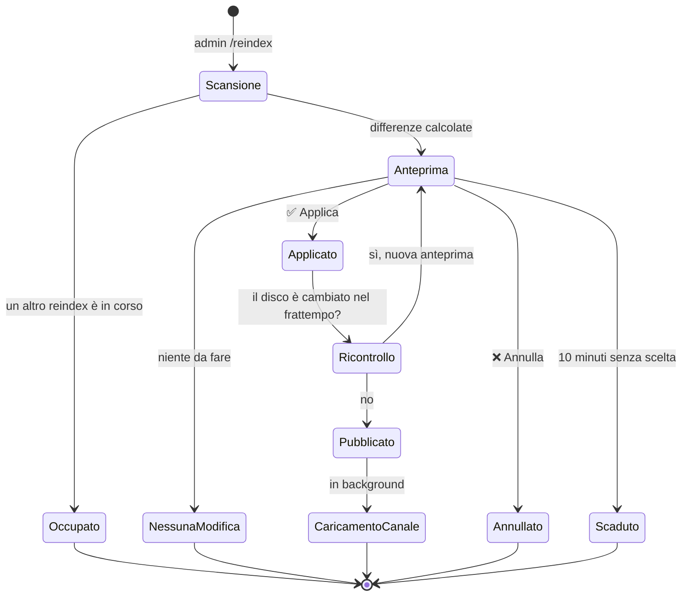
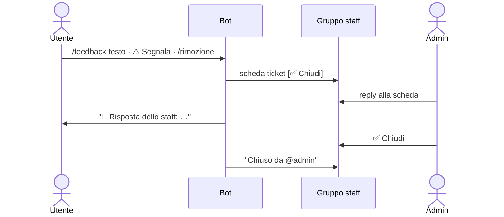
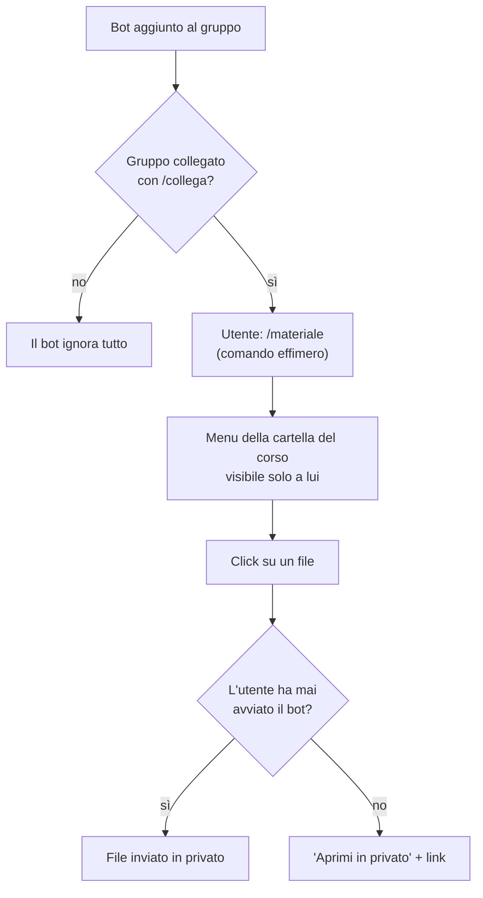
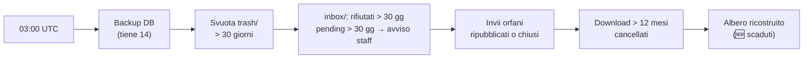

# Come funziona — flussi e diagrammi

Spiegazione del funzionamento del bot, flusso per flusso. I diagrammi sono in
Mermaid (GitHub li mostra come grafici). Qui solo il "cosa succede": per i
comandi dello staff vedi [`GUIDA_ADMIN.md`](GUIDA_ADMIN.md), per il codice
[`SVILUPPO.md`](SVILUPPO.md).

---

## 1. Visione d'insieme

Tre idee alla base:

1. **Il disco decide cosa si vede.** Lo staff gestisce le cartelle in
   `data/prod/archive/`; il bot le pubblica solo con `/reindex`.
2. **Telegram consegna i file.** Ogni file viene caricato una volta nel canale
   storage; agli utenti si invia il suo `file_id`, istantaneo.
3. **Il DB ricorda le persone.** Crediti, acquisti, preferiti, invii, ticket.

---

## 2. Navigare e scaricare

**Il percorso utente non legge mai il disco:** navigazione, ricerca e invii
usano solo l'indice (database, caricato in memoria) e i `file_id` di Telegram.
Il disco lo leggono solo `/reindex` e il caricamento in background nel canale
storage. Un file appena pubblicato e non ancora caricato passa in testa alla
coda e arriva da solo appena pronto (succede soprattutto nelle ore dopo il
primo `/reindex`).

Sotto ogni file: **📤 Condividi** (via inline), **🔗 Copia link**,
**⭐ Salva** nei preferiti, **⚠️ Segnala**.

**📥 Scarica tutto:** manda tutti i file gratuiti della cartella (non delle
sottocartelle), nell'ordine dei bottoni, circa uno al secondo. Sopra i 20 file
chiede conferma.

**Altri modi di arrivare a un file:** ricerca inline `@bot analisi` in qualsiasi
chat, `/cerca analisi`, link `t.me/<bot>?start=f_571`, `/preferiti`,
`/recenti`, `/novita`.

---

## 3. Comprare un file Exclusive

- I crediti **non si comprano**: si guadagnano inviando materiale approvato
  ([§4](#4-inviare-materiale-e-guadagnare-crediti)) o li assegna un admin.
- L'acquisto resta valido se il file viene corretto, rinominato, spostato o
  cambia prezzo.
- Se l'invio fallisce dopo l'acquisto, basta ricliccare: niente doppio addebito.

---

## 4. Inviare materiale (e guadagnare crediti)

Il file approvato è su disco ma **compare agli utenti solo dopo `/reindex`**.

---

## 5. Aggiornare l'archivio (`/reindex`)

Cosa mostra l'anteprima: file nuovi, modificati, spostati/rinominati (che
**tengono lo stesso ID**: link, preferiti e acquisti restano validi), rimossi,
prezzi cambiati, file Exclusive nascosti per prezzo mancante o > 50, file in
copia da meno di 30 secondi.

---

## 6. Feedback, segnalazioni, richieste di rimozione

---

## 7. Gruppi dei corsi

---

## 8. Task notturno (03:00 UTC)

Se il bot era spento a quell'ora, il task parte all'avvio.

I file scaricati dal server Bot API li cancella un piccolo container separato
(`bot-api-cleaner`) dopo 24 ore: il bot non ne ha i permessi.
